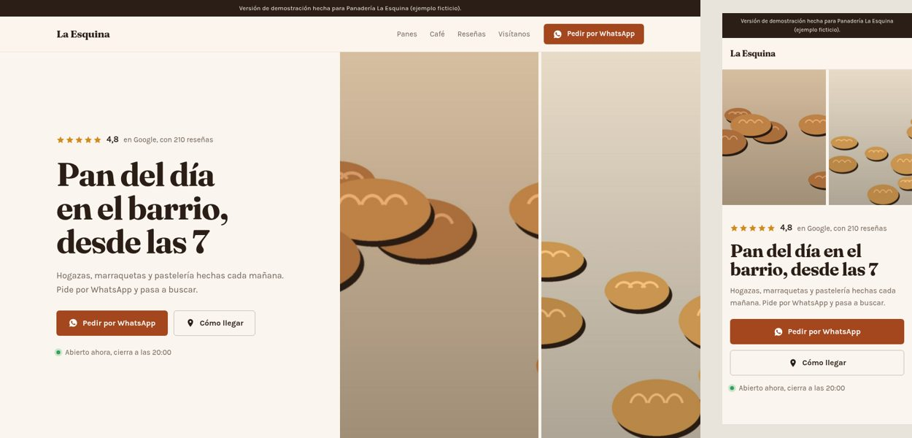

# Generador de sitios para negocios locales

*(English below)*

Generador en Python que crea el sitio de un negocio local a partir de un archivo de datos. Lo construí en noviembre de 2026 para mostrar a pequeños negocios (panaderías, peluquerías, veterinarias, restaurantes) cómo quedaría su página antes de que paguen algo. Con él hice 29 sitios de demostración en 5 países y 3 idiomas.



El negocio de este repositorio es **ficticio**: nombre, teléfono, reseñas e imágenes (dibujadas por código) son inventados. Los sitios de clientes reales no están aquí.

## Qué hace

- **Un solo archivo HTML por negocio**, con CSS, JavaScript y fotos incrustados (las fotos se reducen y se pasan a base64). Se publica en cualquier hosting estático.
- **Tres idiomas:** portugués, inglés y español. Con `bi=True` el sitio es bilingüe PT/EN con botón de idioma; con `lang="es"` todos los textos fijos salen en español.
- **"Abierto ahora / Cerrado ahora"** calculado en la zona horaria del negocio (`tz`), con el horario del día resaltado.
- **Pensado para celular:** barra fija con el botón principal (WhatsApp o llamar), miniaturas en la lista de servicios y abertura con foto grande.
- **Secciones reutilizables:** servicios con foto que cambia, galería, mosaico, destacado, pasos, reseñas, preguntas frecuentes y visita con mapa.
- `noindex` y franja de "versión de demostración" para que la vista previa no aparezca en Google.

## Pruebas automáticas

En `herramientas/`, scripts en Node que controlan Chromium por el protocolo DevTools:

- `capturas.mjs`: captura la página completa en computador (1440x900) y celular (390x844).
- `verificar-boton.mjs`: confirma en el celular que el botón principal aparece sin desplazar la página. Así apareció un error de CSS (una altura mínima que empujaba el botón fuera de la pantalla) que a ojo no se notaba.

## Video de presentación

`video.py` arma un video vertical de 30 s (1080x1920) con Pillow y FFmpeg: escenas de texto, el sitio desplazándose dentro de un celular y la invitación final. La música también se genera por código (`herramientas/musica.py`, con NumPy). Ejemplo: [docs/video-ejemplo.mp4](docs/video-ejemplo.mp4).

## Cómo usar

Requisitos: Python 3.11+, `pip install -r requirements.txt`, Node 20+ y Chromium (para las pruebas), FFmpeg (para el video).

```bash
python3 generar.py                                   # genera salida/<id>/index.html
cd salida && python3 -m http.server 8000             # sirve los sitios en otra terminal
BASE=http://127.0.0.1:8000/ node herramientas/verificar-boton.mjs panaderia-la-esquina
BASE=http://127.0.0.1:8000/ node herramientas/capturas.mjs panaderia-la-esquina
```

Para un negocio nuevo: copia `ejemplo/negocio.py`, cambia los datos y pon las fotos en `ejemplo/fotos/<carpeta>/`.

## Archivos

| Archivo | Para qué sirve |
|---|---|
| `motor.py` | Secciones, botones, íconos y armado de la página. |
| `estilo.css` / `script.js` | Estilo común y comportamiento (idioma, "abierto ahora", fotos de servicios). |
| `ayudas.py` | Funciones para escribir los datos (paleta, fuentes, enlaces de WhatsApp y mapa). |
| `ejemplo/negocio.py` | El negocio ficticio de ejemplo. |
| `generar.py` | Genera los sitios. |
| `video.py`, `ejemplo/textos_video.py` | Video de presentación. |
| `herramientas/` | Capturas, verificación del botón, captura para el video y música. |
| `panel/`, `.pages.yml` | Panel de edición del cliente (Pages CMS) y publicación automática. |

Los comentarios internos del motor están en portugués, el idioma original del proyecto.

## Panel de edición para el cliente

Desde el primer cliente con mensualidad, el dueño del negocio puede editar su propio sitio sin tocar código y sin cuenta de GitHub:

1. Los textos salen de un archivo de datos (`panel/contenido.json` en este ejemplo).
2. **Pages CMS** (`.pages.yml`) muestra ese archivo como un formulario: título, textos, lista de productos (con orden por arrastre) y fotos. El cliente entra con su correo.
3. Al guardar, **GitHub Actions** ejecuta `panel/construir.py`, arma el sitio con el mismo motor y lo publica en **Cloudflare Pages** (`panel/publicar.yml.ejemplo`).
4. El diseño queda bloqueado: el cliente cambia contenido, no colores, fuentes ni estructura.

Costo de infraestructura: cero (Pages CMS, GitHub Actions y Cloudflare Pages en planes gratuitos). En producción lo uso con un estudio contable de Maceió; ese repositorio es privado.

```bash
python3 panel/construir.py        # arma el sitio de ejemplo con los textos de panel/contenido.json
```

## Lo que no hace

No descarga fotos ni reseñas de ningún sitio, no publica nada solo y no envía mensajes. El contenido de cada negocio se escribe a mano en su archivo de datos.

---

# Local business website generator (English)

A Python generator that builds a local business website from a single data file. I built it in November 2026 to show small businesses what their page would look like before they pay anything. I used it for 29 demo sites in 5 countries and 3 languages.

The business in this repository is **fictional** (name, phone, reviews and code-drawn images). Real client sites are not included.

- **One self-contained HTML file per business** (CSS, JS and images embedded).
- **Portuguese, English and Spanish**, including a bilingual PT/EN mode with a language toggle.
- **"Open now"** computed in the business time zone.
- **Mobile first**: sticky action bar, service thumbnails, full-height hero.
- **Automated checks in Chromium** via the DevTools Protocol: full-page screenshots and a check that the main button is visible without scrolling on a phone.
- **30-second vertical presentation video** generated with Pillow and FFmpeg, with code-generated music.

- **Client editing panel**: content lives in a JSON file, edited through Pages CMS (email login, no GitHub account); on save, GitHub Actions rebuilds the site and deploys it to Cloudflare Pages. Layout stays locked. Zero infrastructure cost. See `panel/` and `.pages.yml`.

See the Spanish section above for usage.

## License

MIT, see `LICENSE`.
